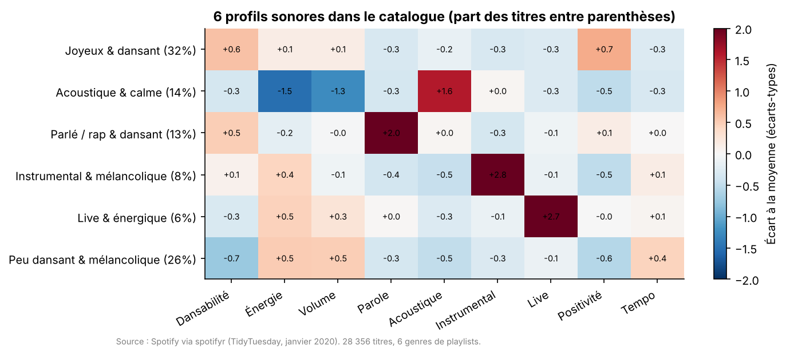
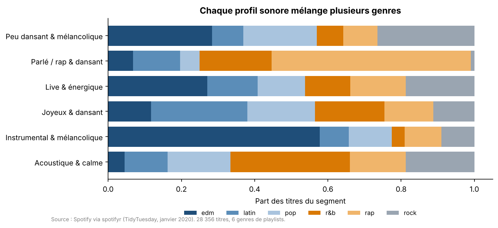
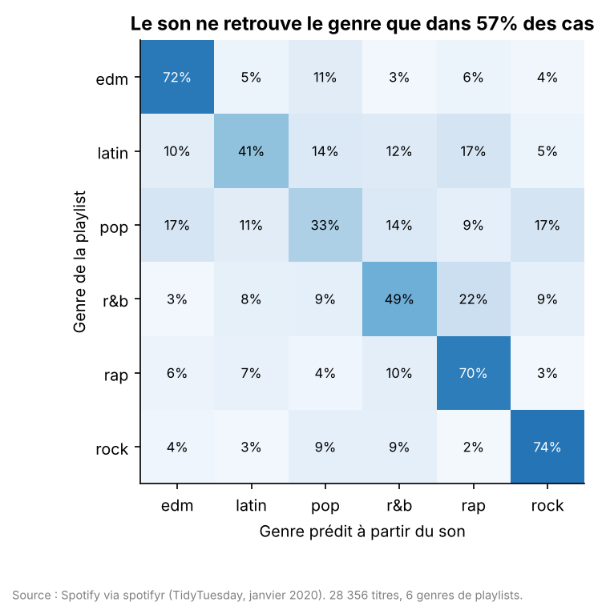
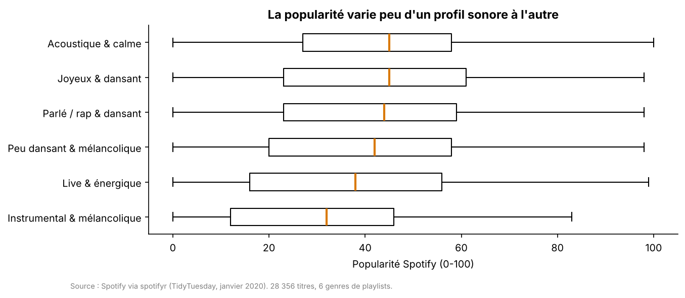

# Segmentation du catalogue Spotify : profils sonores, genres et popularité

**Question métier :** pour une plateforme de streaming ou un éditeur de playlists, peut-on regrouper les titres par « profil sonore » pour aider à la programmation éditoriale, et ces profils disent-ils quelque chose du genre et de la popularité ?

**Données réelles :** 32 833 lignes titre × playlist issues de l'API Spotify (package `spotifyr`, publiées par TidyTuesday en janvier 2020), soit **28 356 titres uniques** répartis dans des playlists de 6 genres (EDM, latin, pop, R&B, rap, rock), avec leurs caractéristiques audio (dansabilité, énergie, acoustique, parole, etc.) et leur popularité (0-100).



## Résultats

| Question | Réponse |
|---|---|
| Combien de profils sonores ? | **6 profils**, retenus par l'indice de silhouette (meilleur score à k = 6) |
| Les profils sont-ils bien séparés ? | **Peu** : silhouette de 0,16. Les profils décrivent des tendances, pas des groupes étanches. C'est attendu pour de la musique, où les styles se recouvrent |
| Le son permet-il de retrouver le genre ? | **En partie** : 57 % de bonnes réponses (contre 17 % au hasard). Très bien pour le rock (74 %), l'EDM (72 %) et le rap (70 %) ; mal pour la pop (33 %), qui ressemble à tous les autres genres |
| Le son explique-t-il la popularité ? | **Très peu** : R² de 0,07 avec le son seul, 0,13 en ajoutant genre et année. La popularité dépend surtout d'autres facteurs (artiste, promotion, mise en playlist) |

**Les 6 profils :**

| Profil | Part des titres | Genre le plus présent | Popularité médiane |
|---|---|---|---|
| Joyeux & dansant | 32 % | latin (26 %) | 45 |
| Peu dansant & mélancolique | 26 % | EDM (28 %) | 42 |
| Acoustique & calme | 14 % | R&B (33 %) | 45 |
| Parlé / rap & dansant | 13 % | rap (54 %) | 44 |
| Instrumental & mélancolique | 8 % | EDM (58 %) | 32 |
| Live & énergique | 6 % | EDM (27 %) | 38 |

**À retenir pour un usage éditorial :**
1. Les profils sonores **traversent les genres** : un profil « Acoustique & calme » mélange R&B, pop, rock et rap. Ils peuvent servir à composer des playlists d'ambiance (« chill », « fête », « focus ») plus fines que les genres.
2. Les titres **instrumentaux** sont nettement moins populaires (médiane 32 contre 45) : un signal utile pour la mise en avant.
3. Le son ne suffit pas à prédire le succès d'un titre : un modèle de recommandation doit combiner le son avec les données d'écoute et de contexte.







## Méthode

1. **Qualité des données :** 4 477 doublons titre × playlist (un même titre dans plusieurs playlists) ramenés à une ligne par titre, avec le genre le plus fréquent ; 1 687 titres présents dans plusieurs genres ; 2 620 titres de popularité nulle, exclus de l'analyse de popularité.
2. **Segmentation :** standardisation de 9 caractéristiques audio, K-Means pour k = 3 à 8, choix de k par l'indice de silhouette, nommage automatique des profils à partir des caractéristiques les plus marquées.
3. **Genre :** forêt aléatoire, validation croisée stratifiée à 5 plis, matrice de confusion.
4. **Popularité :** gradient boosting, validation croisée à 5 plis, R².

## Limites

- Les données datent de janvier 2020 et ne couvrent que 6 genres et les playlists choisies par les auteurs du jeu de données.
- Le genre est celui de la **playlist**, pas du titre lui-même.
- Il n'y a **pas de données d'écoute par utilisateur** : il s'agit d'une segmentation du catalogue, pas des auditeurs.

## Reproduire

```bash
pip install -r requirements.txt
python src/analyse.py   # résultats dans reports/results/, graphiques dans reports/figures/
pytest -q
```

## Source

Spotify Web API via le package R [`spotifyr`](https://www.rcharlie.com/spotifyr/), jeu de données publié par [TidyTuesday (2020-01-21)](https://github.com/rfordatascience/tidytuesday/tree/main/data/2020/2020-01-21).

**Auteure :** Fatma Hammami · Licence MIT
